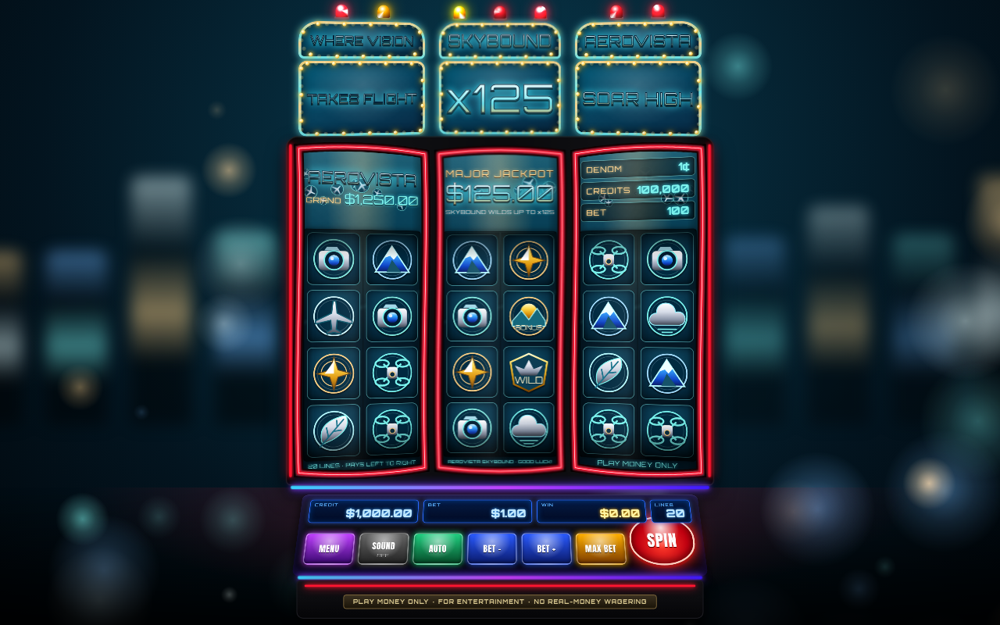
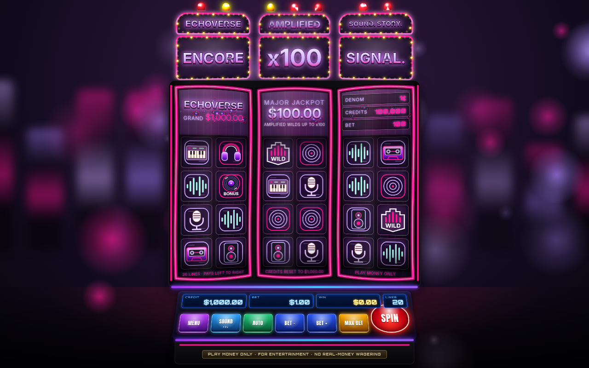

# Triple Curve Slot Cabinet (play money)

A browser slot machine styled as a large three-screen curved upright cabinet: neon-edged S-curved
portrait screens, stacked topper signs with chasing bulbs and beacons, and a lit button deck.
The game on the screens can be swapped from the in-cabinet **MENU**.

**Play money only.** Credits are stored in your browser and have no cash value. There's no real-money
wagering and there are no purchases or outside links.

## Run
Open `index.html` in a modern browser (Chrome, Edge, Firefox or Safari). You don't need a build step or
a network connection. You can also serve the folder: `python3 -m http.server 8000` and open http://localhost:8000.

## Mobile layout

Phones use full-width cabinet artwork with a separate touch deck: controls are at least 44 pixels tall, with a larger Spin button. Landscape puts the controls beside the reels. Menus use readable text and scroll independently; the layout follows browser-bar height changes and allows for screen cutouts. Desktop keeps the full cabinet view.

## Controls
| Action | Button | Key |
|---|---|---|
| Spin / slam-stop / skip count-up | SPIN | Space or Enter |
| Bet down / up | BET − / BET + | − / + (or ↓ / ↑) |
| Max bet + spin | MAX BET | |
| Autoplay toggle | AUTO | A |
| Menu (Games, Paytable, Help, Settings) | MENU | M (Esc closes) |
| Sound on/off | SOUND | S |
| Switch game directly | | 1–9 |

## Gameplay
- The three screens form **one 6-reel × 4-row game**, with 2 reels per screen. There are **20 paylines**
  that run across all three screens and pay left to right for 3+ in a row. Win lines are drawn across the screens.
- **Wild** substitutes for everything except the scatter. Each wild can land with a multiplier tag
  (Wild x125!: x2 / x5 / **x125**). A line win uses the biggest tag on it. The game's top multiplier
  triggers a full-cabinet **"WILD x125!"** celebration.
- **Scatter** (3+ anywhere) pays a multiple of the total bet, then the **Multiplier Bonus** wheel multiplies it.
- Progressive **GRAND** (6 wilds on a line) and **MAJOR** (6 scatters) jackpots grow with each spin.
- Win celebrations scale with win size: highlighted lines, coin bursts, a counting win meter, and BIG / MEGA / EPIC
  overlays with coin rain.
- Sound effects are synthesized with WebAudio. Credits, bet, game, sound and turbo settings persist in
  `localStorage`. You can reset credits in **Menu → Settings**, or from the out-of-credits screen.
- Estimated return to player from a 1M-spin simulation, excluding jackpots: about 90–95% for each game.

## Games
| id | Name | Look |
|---|---|---|
| `wild125` | Wild x125! (default) | Gold coins, purple/blue panels, like the reference cabinet |
| `cyber` | Cyber Surge | Neon wireframe icons on a synthwave grid, wilds up to x100 |
| `fruits` | Lucky 7s | Classic cherries, bells, BARs and 7s, wilds up to x77 |
| `aerovista` | AeroVista Skybound | Teal, silver and gold aviation cabinet; aircraft, drones and mountain horizons; wilds up to x125 |
| `echoverse` | EchoVerse Encore | Velvet purple and amber studio cabinet; vinyl, headphones and mixtapes; wilds up to x100 |

Choose **Menu → Games** or press **4** for AeroVista Skybound and **5** for EchoVerse Encore. The selected game, credits and each game's progressive meters persist locally. AeroVista uses the existing Wild x125 payout configuration; EchoVerse uses the existing Cyber Surge configuration. The new themes add no network dependencies.

## Branded cabinets

| AeroVista Skybound | EchoVerse Encore |
|---|---|
|  |  |

## Adding a new game
1. Copy `games/fruits.js` (or any game) to `games/mygame.js` and change the `id`.
2. Edit the config. Every field drives the cabinet:
   ```js
   SlotGames.register({
     id: 'mygame', name: 'My Game', tagline: 'Shown on the menu card',
     title: 'MY GAME',                       // screen 1 header
     toppers: [{ small: 'TOP', big: 'SIGN' }, { small: 'MID', big: 'SIGN' }, { small: 'TOP', big: 'SIGN' }],
     featureText: 'SHOWN UNDER MAJOR JACKPOT',
     jackpots: { grand: 1000, major: 100 },  // seed values (play $)
     theme: { font, accent, accent2, glow, panelA, panelB, frameA, frameB, topperText, topperStroke,
              screenBg, cellBg, cellBorder, lineColors: [...], bokeh: [...], pageTint, decor /* SVG string */ },
     symbols: [
       { id: 'wild', name: 'WILD', type: 'wild', weight: 2.6, pays: { 3: 25, 4: 100, 5: 400, 6: 1250 }, svg: '<svg…>' },
       { id: 'scat', name: 'BONUS', type: 'scatter', weight: 1.9, pays: {}, svg: '<svg…>' },
       { id: 'hi',   name: 'HIGH', weight: 4, pays: { 3: 12, 4: 40, 5: 150, 6: 500 }, svg: '<svg…>' },
       // ...more symbols. pays = multiples of the line bet (total bet / 20); weight = relative frequency
     ],
     wildMultipliers:  [{ m: 1, w: 78 }, { m: 2, w: 15 }, { m: 5, w: 6 }, { m: 125, w: 0.35 }],
     scatterPays:      { 3: 2, 4: 6, 5: 25, 6: 100 },          // x total bet
     bonusMultipliers: [{ m: 2, w: 34 }, { m: 5, w: 20 }, { m: 125, w: 1 }]
   });
   ```
   You need exactly one `type: 'wild'` and one `type: 'scatter'` symbol. Draw symbol SVGs with the helpers in
   `js/art.js` (`SlotArt.text`, `coin`, `starPts`, `polyHex`, `neon`, `cardLetter`). You can also use any SVG
   on a 100×100 viewBox, along with the shared gradients `url(#g-gold)`, `g-red`, `g-blue` and others.
3. Add `<script src="games/mygame.js"></script>` to `index.html` after the other games. It then shows up in
   Menu → Games automatically.
4. Optional: check the payout balance with Node. The engine and game files run headless:
   ```js
   global.window = global; global.SlotArt = require('./js/art.js'); global.SlotGames = require('./games/registry.js');
   const E = require('./js/engine.js'); require('./games/mygame.js');
   console.log(E.simulate(SlotGames.get('mygame'), 500000)); // { rtp, hitRate, bonusRate, ... }
   ```

## Files
- `index.html`: the cabinet markup and script order
- `css/cabinet.css`: cabinet, toppers, curved screens, deck, menu and animations
- `js/engine.js`: reel math, paylines, wilds, scatters and simulation (no DOM)
- `js/art.js`: shared SVG gradients, filters and drawing helpers
- `js/app.js`: UI, reel animation, win presentation, menu, persistence and input
- `js/audio.js`: WebAudio synth sound effects
- `js/fx.js`: canvas coin and sparkle particles
- `games/registry.js` plus one file per game
- `fonts/`: Anton and Orbitron (SIL Open Font License), Luckiest Guy (Apache 2.0)

## QA hook
`SlotApp.forceNext([[...4 ids], ×6])` forces the next spin's grid, for example `'wild*125'` for a x125 wild.
It's meant for testing and demos.
